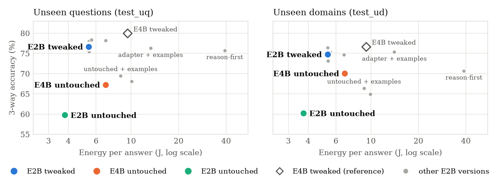

# edge-grader

The code and data behind **"Fine-Tuned Small Language Models for Short-Answer Grading on Edge Devices"** (R. A. Yunanto, J.-S. Leu, D. D. N. Ardiansyah, NTUST; draft for IEEE Transactions on Learning Technologies).

The paper asks whether a school that wants a better grader on the device it already owns should run a larger model or fine-tune the small one. On an NVIDIA Jetson Orin Nano (GPU at 612 MHz), with SciEntsBank's 3-way labels, **Gemma 4 E2B with a QLoRA adapter grades better than untouched Gemma 4 E4B** on unseen questions and unseen domains (+9.4 and +4.7 points, Holm-corrected McNemar p < 10⁻⁶), **and costs less per answer** (5.3–5.4 J against 6.8–6.9 J):



Every number in the paper's Tables II–V is recomputed from the raw runs committed here by one command (step 1 below).

---

## Contents

- [Repository map](#repository-map)
- [Reproducing the paper](#reproducing-the-paper)
  - [1. Check the paper against the committed data (no GPU, seconds)](#1-check-the-paper-against-the-committed-data)
  - [2. Train the adapters (one T4 GPU)](#2-train-the-adapters)
  - [3. Re-run the graders on a Jetson Orin Nano](#3-re-run-the-graders-on-a-jetson-orin-nano)
  - [4. Table by table](#4-table-by-table)
- [Other experiments](#other-experiments)
- [Documentation](#documentation)

---

## Repository map

| folder | what it holds |
|---|---|
| [`src/edge_grader/`](src/edge_grader/) | the grader (`grader.py`: prompt, model call, label parsing), SciEntsBank loading (`data.py`), the runner (`baseline.py`), fine-tuning (`finetune.py`, `reasons.py`, `soup.py`), graded examples (`examples.py`), RAG (`rag/`), board checks and the paper's comparisons (`board_check.py`, `compare_*.py`), and `paper_check.py` |
| [`scripts/`](scripts/) | `board_grade.sh` (one grading run on the Jetson, with telemetry), `deploy.sh` / `fetch_results.sh` (your machine ↔ board), `spark_*.sh` (Docker jobs), `paper_figures.py` |
| [`notebooks/`](notebooks/) | Kaggle: grading (`kaggle_baseline`), fine-tuning (`kaggle_finetune`), the teacher's reasons (`kaggle_reasons`), the RAG index (`kaggle_rag_index`) |
| [`results/`](results/) | every run, committed and never hand-edited; the paper's Jetson runs are in `results/board/`. Layout: [`results/README.md`](results/README.md) |
| [`docs/`](docs/) | research outline and decisions, results pages, designs, literature notes, how-to guides. Index: [`docs/README.md`](docs/README.md) |
| [`manuscript/`](manuscript/) | the paper (`main.tex`, `refs.bib`) |
| [`compose.yaml`](compose.yaml), [`docker/`](docker/) | the same jobs in Docker (DGX Spark or any CUDA machine) |

---

## Reproducing the paper

### 1. Check the paper against the committed data

Needs [uv](https://docs.astral.sh/uv/) and nothing else: no GPU, no models, no network after `uv sync`.

```bash
git clone https://github.com/gnotnek/edge-grader.git
cd edge-grader
uv sync
uv run python -m edge_grader.paper_check
```

It recomputes Tables II–V from the committed runs (each run's summary and per-answer replies in `results/board/`, and the energy and latency in `results/estimates/board-check-*.json`), then prints the paper's value beside the recomputed one, cell by cell:

```
Table II, the three graders
  E2B untouched: test_uq acc (95%)              paper 59.8 (50.1--69.2)   here 59.8 (50.1--69.2)   ok
  ...
every checked number matches the manuscript
```

The exit status is 1 if any cell differs; `--table three|tests|variants|thinking` prints one table. The figures are drawn from the same data:

```bash
uv run --with matplotlib python scripts/paper_figures.py   # docs/results/figures/jetson-*.pdf and .png
```

`uv run pytest` runs the test suite, including an end-to-end run against a fake `llama-server` and the paper check.

### 2. Train the adapters

QLoRA on the SciEntsBank train split (4,969 answers): rank 16, α 32, dropout 0.05 on every attention and feed-forward projection, NF4 base, learning rate 2×10⁻⁴ (cosine, 3% warm-up), effective batch 16, up to 3 epochs; the epoch is picked on 14 held-out train questions. One T4 is enough. Either:

- **Kaggle:** [`notebooks/kaggle_finetune.ipynb`](notebooks/kaggle_finetune.ipynb). Set `MODEL` (`e2b` / `e4b`) and `REPLY`, run once with `SMOKE = True`, then with `SMOKE = False`. It trains, converts the adapter to GGUF with llama.cpp's `convert_lora_to_gguf.py`, and grades with `--lora`. First time on Kaggle: [`docs/guides/kaggle-setup.md`](docs/guides/kaggle-setup.md).
- **Docker:** the `finetune-*` services in [`compose.yaml`](compose.yaml): seeds `-s0`..`-s4`, `-5w-s0`, `-lf`, `-rf`, and `soup-*`. See [`docs/guides/spark-docker.md`](docs/guides/spark-docker.md).

Both call `uv run --group finetune edge-grader-finetune --model e2b --out <dir>`. Training records are in `results/finetune/`; settings, per-epoch scores and the adapters' sha256 in [`docs/results/finetuning.md`](docs/results/finetuning.md). The reason-trained adapters need the teacher's reasons, committed in `results/finetune/raw/` (or rebuilt with [`notebooks/kaggle_reasons.ipynb`](notebooks/kaggle_reasons.ipynb)). The adapter files themselves are not in git.

### 3. Re-run the graders on a Jetson Orin Nano

#### 3.1 What you need

| | used for the paper |
|---|---|
| board | NVIDIA Jetson Orin Nano 8 GB developer kit, NVMe SSD |
| clocks | GPU 612 MHz, memory 2,133 MHz for every thinking-off run (each run records them in `board-state.txt`) |
| server | llama.cpp `llama-server` at `a894dae`, CUDA build, at `~/build/llama.cpp/build/bin/llama-server` |
| models | `unsloth/gemma-4-E2B-it-qat-GGUF` and `unsloth/gemma-4-E4B-it-qat-GGUF`, file `*-UD-Q4_K_XL.gguf`, in `~/research/models/` |
| adapters | the GGUF adapters from step 2, in `~/research/models/adapters/` |
| telemetry | the lab's [`agentic-edge`](https://github.com/rifkyariy/agentic-edge) at `~/research/agentic-edge`, for `benchmark/run_measured.sh` (board power rails over the grading window) |

**Keep one clock state for every run you compare.** Energy only compares within one GPU clock and power mode. The thinking-on runs (Table V) came later at higher clocks, so the paper marks their energy as approximate.

#### 3.2 Run

Put this repository at `~/research/edge-grader` on the board (or run `scripts/deploy.sh jetson` from your machine: it rsyncs the committed files, installs uv and runs the tests there). Then, on the idle board:

```bash
scripts/board_grade.sh e2b test_uq                                                  # E2B untouched
LORA=~/research/models/adapters/e2b-ft.gguf scripts/board_grade.sh e2b test_uq      # E2B tweaked
scripts/board_grade.sh e4b test_uq                                                  # E4B untouched
LORA=~/research/models/adapters/e4b-ft.gguf scripts/board_grade.sh e4b test_uq      # E4B tweaked (reference)
```

Repeat each with `test_ud`. Every run starts its own `llama-server` with the same flags (8,192 context, all layers on the GPU, thinking off, `--cache-ram 0`), grades inside `run_measured.sh`, writes `results/board/<run>/`, and restores the board when it exits. `DRY_RUN=1` prints what it would do; `MEASURE=0` skips telemetry (accuracy only). The versions of Tables IV and V, one option each:

```bash
LORA=.../e2b-ft-s0.gguf scripts/board_grade.sh e2b test_uq          # a seed (s0..s4), or e2b-ft-soup.gguf
LORA=.../e2b-ft-5w-s0.gguf PROMPT_SCHEME=5way scripts/board_grade.sh e2b test_uq
LORA=.../e2b-ft-lf.gguf REPLY=label-first scripts/board_grade.sh e2b test_uq     # or e2b-ft-rf.gguf, reason-first
EXAMPLES=results/examples/examples-knn-bge-small-en-k4.json scripts/board_grade.sh e2b test_uq   # with or without LORA
EXAMPLES=results/examples/examples-random-k4.json scripts/board_grade.sh e2b test_uq
THINKING=on scripts/board_grade.sh e2b test_uq                       # with or without LORA
```

Bring the runs back with `scripts/fetch_results.sh`, score them, and rebuild the tables:

```bash
uv run edge-grader-board-check results/board/<run>/ ...   # writes results/estimates/board-check-*.json
uv run python -m edge_grader.compare_jetson               # Tables II-IV, writes compare-jetson-*.json
uv run python -m edge_grader.compare_thinking             # Table V, writes compare-thinking-*.json
uv run python -m edge_grader.paper_check
```

Without a Jetson, accuracy alone can be re-run on any GPU: start `llama-server` with the flags above and run `uv run edge-grader-baseline --label e2b --split test_uq --n 0` (or use [`notebooks/kaggle_baseline.ipynb`](notebooks/kaggle_baseline.ipynb)). Kaggle T4 and board accuracy agreed within noise when both were run ([`docs/results/baselines.md`](docs/results/baselines.md)).

### 4. Table by table

| paper | runs | recomputed by | write-up |
|---|---|---|---|
| Table I, setup | — | — | [`research-outline.md`](docs/research-outline.md) |
| Table II, the three graders | `results/board/{e2b,ft-e2b,e4b,ft-e4b}-jetson-test_u{q,d}-2026111*` | `compare_jetson` | [`jetson-graders.md`](docs/results/jetson-graders.md) |
| Table III, paired tests | same | `compare_jetson` (McNemar, Holm over 8) | [`jetson-graders.md`](docs/results/jetson-graders.md) |
| Table IV, every E2B version | `results/board/{ft-s*,ft-soup,ft-5w-s0,ft-lf,ft-rf,ex4,ex4-ft,rand4}-e2b-jetson-*` | `compare_jetson` | [`jetson-graders.md`](docs/results/jetson-graders.md), [`finetuning.md`](docs/results/finetuning.md), [`examples.md`](docs/results/examples.md) |
| Table V, thinking | `results/board/*think*-e2b-jetson-*` | `compare_thinking` (Holm over 22) | [`jetson-graders.md`](docs/results/jetson-graders.md#thinking-on-with-every-e2b-adapter-2026-11-16-to-11-20) |
| Figs. 3–4 | as Tables II–V | `scripts/paper_figures.py` | — |
| RAG paragraph | `results/kaggle/{baseline,rag}-*` | — | [`rag.md`](docs/results/rag.md) |
| Beetle + SAF transfer | `results/kaggle/*beetle-saf*`, `results/spark/*beetle-saf*` | — | [`finetuning.md`](docs/results/finetuning.md) |

`paper_check` covers the tables. The RAG and transfer numbers in the text aren't checked by it yet; their pages give the runs and tests.

---

## Other experiments

The project ran more than the paper reports. Those experiments, with their code, runs and write-ups, are on the [`experiments`](https://github.com/gnotnek/edge-grader/tree/experiments) branch (this repository as of 2026-11-27, before `main` was trimmed to the paper):

- ASAP 2.0 essay scoring on the DGX Spark
- topic benchmarks: GSM8K / GSM-Symbolic (math) and LiveNewsBench (post-cutoff news), with RAG
- MMLU-Pro on the lab's 300-question subset, and as a no-harm check after fine-tuning
- engine variants on the Jetson: little-gemma, prefix reuse, `--swa-full`
- the Raspberry Pi 5 baseline and thinking-on runs
- cascade and defer-to-teacher, simulated from Jetson runs
- the boards' job queue and a local dashboard
- the plan and week-by-week timeline (`docs/plan.md`)

## Documentation

[`docs/README.md`](docs/README.md) indexes every page. Start with [`research-summary.md`](docs/research-summary.md) (plain words), then [`research-outline.md`](docs/research-outline.md) (research questions and every decision with its reason) and [`results/summary.md`](docs/results/summary.md) (every finding by research question).

**Metrics:** accuracy and macro-F1, the SemEval-2013 metrics. SciEntsBank's labels are categories, so QWK isn't used.

**Rules for new runs:** board runs go through `scripts/board_grade.sh` directly, never through `agentic-edge`'s job queue, and nothing is written into `agentic-edge`'s folders (the script enforces both). Every run writes a summary JSON with its settings to `results/`; result files are never hand-edited.
