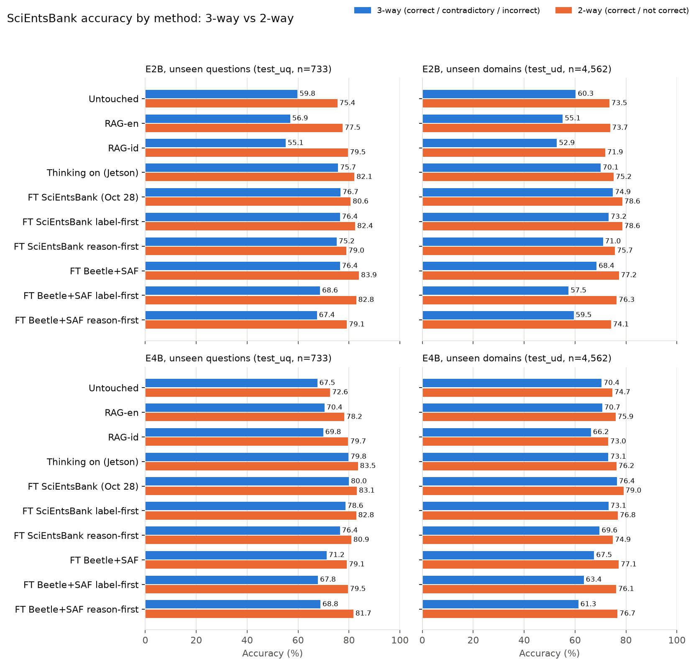
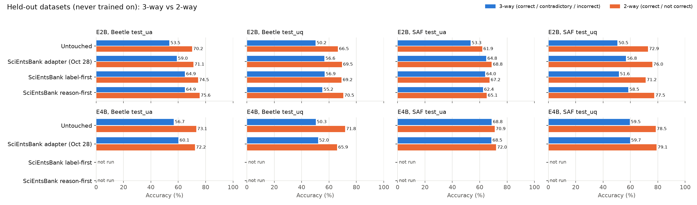
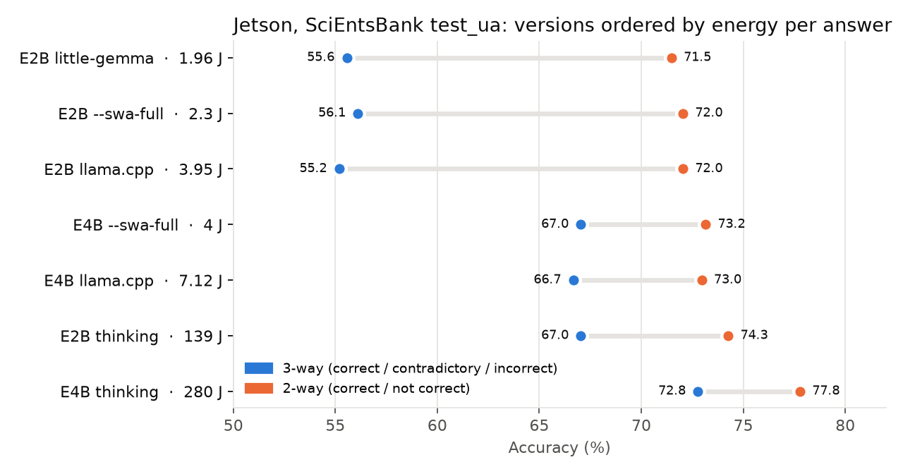

# Recap: every grading result, 3-way and 2-way

*Written 2026-11-09. One page for every SciEntsBank, Beetle and SAF grading run in `results/`, scored both ways. The detailed write-ups, tests and caveats stay on the linked pages; [summary.md](summary.md) is the narrative across stages.*

**How to read the numbers**
- **3-way** is the project's metric: correct / contradictory / incorrect. Every decision (the 5-point bar, Holm families) was made on 3-way.
- **2-way** merges "contradictory" into "incorrect", so it asks only *is this answer correct?* It is computed from the same per-answer predictions (`raw/*.jsonl`); nothing was re-run. Most SciEntsBank papers report it beside 3-way. It was added after grading (2026-11-09), so it describes, it doesn't decide.
- Each cell is **accuracy % (macro-F1)**.
- Splits: **test_ua** unseen answers (n = 540), **test_uq** unseen questions (733), **test_ud** unseen domains (4,562). The adapters trained on SciEntsBank share test_ua's questions, so only test_uq and test_ud are held out for them.
- SAF has no "contradictory" gold label, so its 3-way score counts a "contradictory" reply as wrong; 2-way is the fairer SAF number.
- Regenerate the tables and figures with `uv run --with matplotlib python scripts/recap_figures.py`. It checks every 3-way accuracy against the run's own summary JSON.

## What the 2-way view adds

1. **Most of the untouched models' errors are the contradictory/incorrect line.** Untouched E2B goes from 55–60% (3-way) to 72–75% (2-way); E4B from 67–70% to 73–75%. E4B's 7–11-point lead in 3-way becomes −2.8 to +1.3 points in 2-way: on *is it correct?* the two untouched models are about equal.
2. **Fine-tuning is the best method either way.** The SciEntsBank adapters reach 75–84% 2-way (70–80% 3-way). Their 2-way gains over the untouched model are smaller than the 3-way ones (+0.2 to +10.5 against −0.8 to +16.9) but significant on 10 of 12 held-out cells (Holm, [compare-bar](../../results/kaggle/compare-bar-scientsbank-20261109-065502.json)).
3. **The Beetle + SAF adapters look much better in 2-way.** In 3-way they lose to the untouched model on test_ud (E4B −2.9 to −9.1). In 2-way every one is at or above it (+0.2 to +9.1), and E2B's label-only one has the highest test_uq of any run (83.9%). Their 3-way losses are the contradictory/incorrect line ([why](finetuning.md#why-e4b-loses-the-contradictoryincorrect-boundary-2026-11-09-post-hoc)).
4. **Thinking's gain shrinks in 2-way:** E2B +10 to +19 (3-way) becomes +2 to +8; E4B +3 to +13 becomes +2 to +11. A good part of what thinking fixes is telling contradictory from incorrect.
5. **RAG reverses sign.** RAG-en costs E2B 2 to 5 points in 3-way but adds 0 to 2 in 2-way; RAG-id adds up to 7 in 2-way on test_ua/test_uq and still loses on test_ud. Consistent with [rag.md](rag.md): the passages make the model call more answers correct, which helps "correct vs not" and hurts the three-label split. 2-way RAG differences are not significance-tested.
6. **Platform and engine don't matter in either view.** Kaggle, Jetson and Pi 5 agree within 1 point in both views; little-gemma and `--swa-full` likewise.
7. **On held-out datasets the adapters' gains stay small in 2-way.** E2B's adapters add +1 to +5 on Beetle and −2 to +7 on SAF; E4B's Oct 28 adapter loses 6 points 2-way on Beetle test_uq. The SciEntsBank fit still mostly doesn't transfer.

## Figures

*Figure 1. Every method on the two held-out SciEntsBank splits. Thinking is the Jetson run; everything else is Kaggle T4.*

*Figure 2. Adapters trained on SciEntsBank, graded on two datasets they never saw. The E4B label-first and reason-first adapters weren't run on these.*

*Figure 3. The Jetson's accuracy ladder on test_ua at 612 MHz. Energy per answer is board DC draw from [summary.md](summary.md#rq4-what-does-it-cost-on-the-boards); accuracy from the same runs.*

## All grading runs

### SciEntsBank, E2B

| Section | Version | Platform | test_ua 3-way | test_ua 2-way | test_uq 3-way | test_uq 2-way | test_ud 3-way | test_ud 2-way |
|---|---|---|---|---|---|---|---|---|
| Untouched | Untouched | Kaggle T4 | 55.2 (0.52) | 71.5 (0.68) | 59.8 (0.55) | 75.4 (0.72) | 60.3 (0.57) | 73.5 (0.72) |
| Untouched | Untouched | Jetson | 55.2 (0.52) | 72.0 (0.69) | 59.8 (0.55) | 75.6 (0.72) | 60.2 (0.57) | 73.3 (0.72) |
| Untouched | Untouched | Pi 5 | 55.7 (0.53) | 72.0 (0.69) | 59.8 (0.55) | 75.8 (0.72) | 60.4 (0.57) | 73.3 (0.72) |
| Untouched | little-gemma engine | Jetson | 55.6 (0.52) | 71.5 (0.68) | — | — | — | — |
| Untouched | `--swa-full` prefix reuse | Jetson | 56.1 (0.53) | 72.0 (0.69) | — | — | — | — |
| RAG | RAG-en (top 3) | Kaggle T4 | 53.3 (0.51) | 73.7 (0.72) | 56.9 (0.54) | 77.5 (0.76) | 55.1 (0.52) | 73.7 (0.73) |
| RAG | RAG-en (top 3) | Jetson | 53.1 (0.51) | 73.9 (0.72) | 55.9 (0.53) | 76.9 (0.75) | 55.7 (0.52) | 74.0 (0.73) |
| RAG | RAG-id (top 3) | Kaggle T4 | 52.6 (0.51) | 75.2 (0.73) | 55.1 (0.53) | 79.5 (0.78) | 52.9 (0.50) | 71.9 (0.71) |
| Thinking | Thinking on (budget 320) | Jetson | 67.0 (0.64) | 74.3 (0.72) | 75.7 (0.69) | 82.1 (0.81) | 70.1 (0.68) | 75.2 (0.74) |
| Thinking | Thinking on (budget 320) | Pi 5 | 66.7 (0.64) | 73.5 (0.72) | 78.6 (0.74) | 83.5 (0.82) | — | — |
| Fine-tuned | SciEntsBank adapter (Oct 28) | Kaggle T4 | 79.4 (0.79) | 83.3 (0.83) | 76.7 (0.75) | 80.6 (0.80) | 74.9 (0.75) | 78.6 (0.78) |
| Fine-tuned | SciEntsBank label-first | Kaggle T4 | — | — | 76.4 (0.73) | 82.4 (0.82) | 73.2 (0.72) | 78.6 (0.78) |
| Fine-tuned | SciEntsBank reason-first | Kaggle T4 | — | — | 75.2 (0.72) | 79.0 (0.78) | 71.0 (0.68) | 75.7 (0.75) |
| Fine-tuned | Beetle + SAF adapter | Kaggle T4 | 69.3 (0.62) | 78.9 (0.78) | 76.4 (0.69) | 83.9 (0.83) | 68.4 (0.61) | 77.2 (0.77) |
| Fine-tuned | Beetle + SAF label-first | Kaggle T4 | 59.6 (0.55) | 75.2 (0.74) | 68.6 (0.64) | 82.8 (0.82) | 57.5 (0.52) | 76.3 (0.76) |
| Fine-tuned | Beetle + SAF reason-first | Kaggle T4 | 56.1 (0.51) | 71.7 (0.71) | 67.4 (0.61) | 79.1 (0.79) | 59.5 (0.53) | 74.1 (0.74) |

### SciEntsBank, E4B

| Section | Version | Platform | test_ua 3-way | test_ua 2-way | test_uq 3-way | test_uq 2-way | test_ud 3-way | test_ud 2-way |
|---|---|---|---|---|---|---|---|---|
| Untouched | Untouched | Kaggle T4 | 66.7 (0.66) | 72.8 (0.69) | 67.5 (0.65) | 72.6 (0.67) | 70.4 (0.70) | 74.7 (0.73) |
| Untouched | Untouched | Jetson | 66.7 (0.66) | 73.0 (0.69) | 67.3 (0.65) | 72.4 (0.67) | 70.1 (0.70) | 74.3 (0.72) |
| Untouched | Untouched | Pi 5 | 66.5 (0.66) | 72.6 (0.69) | 68.2 (0.66) | 73.4 (0.69) | 70.2 (0.70) | 74.5 (0.73) |
| Untouched | little-gemma engine | Jetson | 66.5 (0.65) | 72.8 (0.69) | — | — | — | — |
| Untouched | `--swa-full` prefix reuse | Jetson | 67.0 (0.66) | 73.2 (0.70) | — | — | — | — |
| RAG | RAG-en (top 3) | Kaggle T4 | 65.6 (0.63) | 74.8 (0.72) | 70.4 (0.66) | 78.2 (0.75) | 70.7 (0.70) | 75.9 (0.74) |
| RAG | RAG-en (top 3) | Jetson | 64.8 (0.63) | 73.7 (0.71) | 69.8 (0.65) | 77.5 (0.74) | 70.6 (0.70) | 75.9 (0.74) |
| RAG | RAG-id (top 3) | Kaggle T4 | 65.6 (0.63) | 76.7 (0.75) | 69.8 (0.65) | 79.7 (0.77) | 66.2 (0.65) | 73.0 (0.72) |
| Thinking | Thinking on (budget 320) | Jetson | 72.8 (0.73) | 77.8 (0.76) | 79.8 (0.78) | 83.5 (0.82) | 73.1 (0.74) | 76.2 (0.75) |
| Thinking | Thinking on (budget 320) | Pi 5 | 72.0 (0.72) | 77.0 (0.75) | 79.1 (0.77) | 82.8 (0.82) | — | — |
| Fine-tuned | SciEntsBank adapter (Oct 28) | Kaggle T4 | 79.1 (0.77) | 83.9 (0.83) | 80.0 (0.79) | 83.1 (0.82) | 76.4 (0.77) | 79.0 (0.79) |
| Fine-tuned | SciEntsBank label-first | Kaggle T4 | 77.2 (0.75) | 82.6 (0.82) | 78.6 (0.76) | 82.8 (0.82) | 73.1 (0.74) | 76.8 (0.76) |
| Fine-tuned | SciEntsBank reason-first | Kaggle T4 | 75.9 (0.73) | 82.2 (0.82) | 76.4 (0.74) | 80.9 (0.80) | 69.6 (0.68) | 74.9 (0.75) |
| Fine-tuned | Beetle + SAF adapter | Kaggle T4 | 65.4 (0.60) | 75.9 (0.73) | 71.2 (0.66) | 79.1 (0.77) | 67.5 (0.59) | 77.1 (0.76) |
| Fine-tuned | Beetle + SAF label-first | Kaggle T4 | 61.7 (0.59) | 76.7 (0.74) | 67.8 (0.64) | 79.5 (0.77) | 63.4 (0.60) | 76.1 (0.75) |
| Fine-tuned | Beetle + SAF reason-first | Kaggle T4 | 58.0 (0.54) | 75.7 (0.75) | 68.8 (0.63) | 81.7 (0.81) | 61.3 (0.55) | 76.7 (0.76) |

### Beetle and SAF, E2B

| Version | Beetle test_ua 3-way | Beetle test_ua 2-way | Beetle test_uq 3-way | Beetle test_uq 2-way | SAF test_ua 3-way | SAF test_ua 2-way | SAF test_uq 3-way | SAF test_uq 2-way |
|---|---|---|---|---|---|---|---|---|
| Untouched | 53.5 (0.53) | 70.2 (0.68) | 50.2 (0.50) | 66.5 (0.65) | 53.3 (0.56) | 61.9 (0.61) | 50.5 (0.55) | 72.9 (0.73) |
| SciEntsBank adapter (Oct 28) | 59.0 (0.53) | 71.1 (0.71) | 56.6 (0.50) | 69.5 (0.69) | 64.8 (0.60) | 68.8 (0.64) | 56.8 (0.61) | 76.0 (0.76) |
| SciEntsBank label-first | 64.9 (0.60) | 74.5 (0.74) | 56.9 (0.52) | 69.2 (0.69) | 64.0 (0.63) | 67.2 (0.66) | 51.6 (0.58) | 71.2 (0.71) |
| SciEntsBank reason-first | 64.9 (0.58) | 75.6 (0.76) | 55.2 (0.48) | 70.5 (0.70) | 62.4 (0.59) | 65.1 (0.62) | 58.5 (0.61) | 77.5 (0.77) |

### Beetle and SAF, E4B

| Version | Beetle test_ua 3-way | Beetle test_ua 2-way | Beetle test_uq 3-way | Beetle test_uq 2-way | SAF test_ua 3-way | SAF test_ua 2-way | SAF test_uq 3-way | SAF test_uq 2-way |
|---|---|---|---|---|---|---|---|---|
| Untouched | 56.7 (0.54) | 73.1 (0.71) | 50.3 (0.48) | 71.8 (0.70) | 68.8 (0.69) | 70.9 (0.70) | 59.5 (0.63) | 78.5 (0.78) |
| SciEntsBank adapter (Oct 28) | 60.1 (0.53) | 72.2 (0.72) | 52.0 (0.45) | 65.9 (0.66) | 68.5 (0.62) | 72.0 (0.67) | 59.7 (0.61) | 79.1 (0.79) |

<!-- source files -->
<!-- results/kaggle/baseline-e2b-kaggle-t4-test_ua-3way-20261005-100102.json n=540 -->
<!-- results/kaggle/baseline-e2b-kaggle-t4-test_uq-3way-20261005-100230.json n=733 -->
<!-- results/kaggle/baseline-e2b-kaggle-t4-test_ud-3way-20261005-101102.json n=4562 -->
<!-- results/board/e2b-jetson-test_ua-20261021-010205/baseline-e2b-jetson-test_ua-3way-20261020-170635.json n=540 -->
<!-- results/board/e2b-jetson-test_uq-20261021-011529/baseline-e2b-jetson-test_uq-3way-20261020-172039.json n=733 -->
<!-- results/board/e2b-jetson-test_ud-20261021-012132/baseline-e2b-jetson-test_ud-3way-20261020-174308.json n=4562 -->
<!-- results/board/e2b-pi5-test_ua-20261004-225353/baseline-e2b-pi5-test_ua-3way-20261004-152538.json n=540 -->
<!-- results/board/e2b-pi5-test_uq-20261009-005557/baseline-e2b-pi5-test_uq-3way-20261008-173650.json n=733 -->
<!-- results/board/e2b-pi5-test_ud-20261009-013741/baseline-e2b-pi5-test_ud-3way-20261008-213738.json n=4562 -->
<!-- results/board/lg-e2b-jetson-test_ua-20261013-152608/baseline-e2b-jetson-test_ua-3way-20261013-072844.json n=540 -->
<!-- results/board/swafull-e2b-jetson-test_ua-20261013-153327/baseline-e2b-jetson-test_ua-3way-20261013-073659.json n=540 -->
<!-- results/kaggle/rag-e2b-kaggle-t4-en-k3-test_ua-3way-20261005-073653.json n=540 -->
<!-- results/kaggle/rag-e2b-kaggle-t4-en-k3-test_uq-3way-20261005-073808.json n=733 -->
<!-- results/kaggle/rag-e2b-kaggle-t4-en-k3-test_ud-3way-20261005-074509.json n=4562 -->
<!-- results/board/rag-e2b-jetson-test_ua-20261019-233020/rag-e2b-jetson-test_ua-3way-20261019-153627.json n=540 -->
<!-- results/board/rag-e2b-jetson-test_uq-20261019-235316/rag-e2b-jetson-test_uq-3way-20261019-155809.json n=733 -->
<!-- results/board/rag-e2b-jetson-test_ud-20261020-000746/rag-e2b-jetson-test_ud-3way-20261019-162728.json n=4562 -->
<!-- results/kaggle/rag-e2b-kaggle-t4-id-k3-test_ua-3way-20261005-115527.json n=540 -->
<!-- results/kaggle/rag-e2b-kaggle-t4-id-k3-test_uq-3way-20261005-115651.json n=733 -->
<!-- results/kaggle/rag-e2b-kaggle-t4-id-k3-test_ud-3way-20261005-120426.json n=4562 -->
<!-- results/board/think-e2b-jetson-test_ua-20261011-232209/think-e2b-jetson-test_ua-3way-20261011-172734.json n=540 -->
<!-- results/board/think-e2b-jetson-test_uq-20261012-052845/think-e2b-jetson-test_uq-3way-20261012-001547.json n=733 -->
<!-- results/board/think-e2b-jetson-test_ud-20261012-132931/think-e2b-jetson-test_ud-3way-20261012-223659.json n=4562 -->
<!-- results/board/think-e2b-pi5-test_ua-20261011-232210/think-e2b-pi5-test_ua-3way-20261011-215644.json n=540 -->
<!-- results/board/think-e2b-pi5-test_uq-20261012-184819/think-e2b-pi5-test_uq-3way-20261012-191123.json n=733 -->
<!-- results/kaggle/baseline-e2b-kaggle-t4-ft-test_ua-3way-20261028-075708.json n=540 -->
<!-- results/kaggle/baseline-e2b-kaggle-t4-ft-test_uq-3way-20261028-074544.json n=733 -->
<!-- results/kaggle/baseline-e2b-kaggle-t4-ft-test_ud-3way-20261028-075550.json n=4562 -->
<!-- results/kaggle/baseline-e2b-kaggle-t4-ft-lf-test_uq-3way-20261102-165537.json n=733 -->
<!-- results/kaggle/baseline-e2b-kaggle-t4-ft-lf-test_ud-3way-20261102-170543.json n=4562 -->
<!-- results/kaggle/baseline-e2b-kaggle-t4-ft-rf-test_uq-3way-20261102-174744.json n=733 -->
<!-- results/kaggle/baseline-e2b-kaggle-t4-ft-rf-test_ud-3way-20261102-190244.json n=4562 -->
<!-- results/kaggle/baseline-e2b-kaggle-t4-ft-beetle-saf-test_ua-3way-20261108-122403.json n=540 -->
<!-- results/kaggle/baseline-e2b-kaggle-t4-ft-beetle-saf-test_uq-3way-20261108-122543.json n=733 -->
<!-- results/kaggle/baseline-e2b-kaggle-t4-ft-beetle-saf-test_ud-3way-20261108-123527.json n=4562 -->
<!-- results/kaggle/baseline-e2b-kaggle-t4-ft-lf-beetle-saf-test_ua-3way-20261108-122901.json n=540 -->
<!-- results/kaggle/baseline-e2b-kaggle-t4-ft-lf-beetle-saf-test_uq-3way-20261108-123050.json n=733 -->
<!-- results/kaggle/baseline-e2b-kaggle-t4-ft-lf-beetle-saf-test_ud-3way-20261108-124141.json n=4562 -->
<!-- results/kaggle/baseline-e2b-kaggle-t4-ft-rf-beetle-saf-test_ua-3way-20261108-055537.json n=540 -->
<!-- results/kaggle/baseline-e2b-kaggle-t4-ft-rf-beetle-saf-test_uq-3way-20261108-060831.json n=733 -->
<!-- results/kaggle/baseline-e2b-kaggle-t4-ft-rf-beetle-saf-test_ud-3way-20261108-072653.json n=4562 -->
<!-- results/kaggle/baseline-e4b-kaggle-t4-test_ua-3way-20261005-094349.json n=540 -->
<!-- results/kaggle/baseline-e4b-kaggle-t4-test_uq-3way-20261005-094608.json n=733 -->
<!-- results/kaggle/baseline-e4b-kaggle-t4-test_ud-3way-20261005-095948.json n=4562 -->
<!-- results/board/e4b-jetson-test_ua-20261021-010729/baseline-e4b-jetson-test_ua-3way-20261020-171435.json n=540 -->
<!-- results/board/e4b-jetson-test_uq-20261021-050938/baseline-e4b-jetson-test_uq-3way-20261020-211839.json n=733 -->
<!-- results/board/e4b-jetson-test_ud-20261021-051933/baseline-e4b-jetson-test_ud-3way-20261020-215558.json n=4562 -->
<!-- results/board/e4b-pi5-test_ua-20261004-232640/baseline-e4b-pi5-test_ua-3way-20261004-162910.json n=540 -->
<!-- results/board/e4b-pi5-test_uq-20261009-130818/baseline-e4b-pi5-test_uq-3way-20261009-062852.json n=733 -->
<!-- results/board/e4b-pi5-test_ud-20261009-142944/baseline-e4b-pi5-test_ud-3way-20261009-141611.json n=4562 -->
<!-- results/board/lg-e4b-jetson-test_ua-20261013-153753/baseline-e4b-jetson-test_ua-3way-20261013-074645.json n=540 -->
<!-- results/board/swafull-e4b-jetson-test_ua-20261013-155606/baseline-e4b-jetson-test_ua-3way-20261013-080256.json n=540 -->
<!-- results/kaggle/rag-e4b-kaggle-t4-en-k3-test_ua-3way-20261005-072157.json n=540 -->
<!-- results/kaggle/rag-e4b-kaggle-t4-en-k3-test_uq-3way-20261005-072355.json n=733 -->
<!-- results/kaggle/rag-e4b-kaggle-t4-en-k3-test_ud-3way-20261005-073507.json n=4562 -->
<!-- results/board/rag-e4b-jetson-test_ua-20261019-234221/rag-e4b-jetson-test_ua-3way-20261019-155222.json n=540 -->
<!-- results/board/rag-e4b-jetson-test_uq-20261019-235903/rag-e4b-jetson-test_uq-3way-20261019-160652.json n=733 -->
<!-- results/board/rag-e4b-jetson-test_ud-20261020-002824/rag-e4b-jetson-test_ud-3way-20261019-165920.json n=4562 -->
<!-- results/kaggle/rag-e4b-kaggle-t4-id-k3-test_ua-3way-20261005-113859.json n=540 -->
<!-- results/kaggle/rag-e4b-kaggle-t4-id-k3-test_uq-3way-20261005-114108.json n=733 -->
<!-- results/kaggle/rag-e4b-kaggle-t4-id-k3-test_ud-3way-20261005-115314.json n=4562 -->
<!-- results/board/think-e4b-jetson-test_ua-20261012-012827/think-e4b-jetson-test_ua-3way-20261011-212751.json n=540 -->
<!-- results/board/think-e4b-jetson-test_uq-20261012-081640/think-e4b-jetson-test_uq-3way-20261012-052838.json n=733 -->
<!-- results/board/think-e4b-jetson-test_ud-20261013-160350/think-e4b-jetson-test_ud-3way-20261014-163310.json n=4562 -->
<!-- results/board/think-e4b-pi5-test_ua-20261012-055736/think-e4b-pi5-test_ua-3way-20261012-104725.json n=540 -->
<!-- results/board/think-e4b-pi5-test_uq-20261013-031216/think-e4b-pi5-test_uq-3way-20261013-122441.json n=733 -->
<!-- results/kaggle/baseline-e4b-kaggle-t4-ft-test_ua-3way-20261028-081758.json n=540 -->
<!-- results/kaggle/baseline-e4b-kaggle-t4-ft-test_uq-3way-20261028-080014.json n=733 -->
<!-- results/kaggle/baseline-e4b-kaggle-t4-ft-test_ud-3way-20261028-081558.json n=4562 -->
<!-- results/kaggle/baseline-e4b-kaggle-t4-ft-lf-test_ua-3way-20261108-133400.json n=540 -->
<!-- results/kaggle/baseline-e4b-kaggle-t4-ft-lf-test_uq-3way-20261108-133644.json n=733 -->
<!-- results/kaggle/baseline-e4b-kaggle-t4-ft-lf-test_ud-3way-20261108-135259.json n=4562 -->
<!-- results/kaggle/baseline-e4b-kaggle-t4-ft-rf-test_ua-3way-20261108-055849.json n=540 -->
<!-- results/kaggle/baseline-e4b-kaggle-t4-ft-rf-test_uq-3way-20261108-061948.json n=733 -->
<!-- results/kaggle/baseline-e4b-kaggle-t4-ft-rf-test_ud-3way-20261108-082726.json n=4562 -->
<!-- results/kaggle/baseline-e4b-kaggle-t4-ft-beetle-saf-test_ua-3way-20261108-123738.json n=540 -->
<!-- results/kaggle/baseline-e4b-kaggle-t4-ft-beetle-saf-test_uq-3way-20261108-124011.json n=733 -->
<!-- results/kaggle/baseline-e4b-kaggle-t4-ft-beetle-saf-test_ud-3way-20261108-125514.json n=4562 -->
<!-- results/kaggle/baseline-e4b-kaggle-t4-ft-lf-beetle-saf-test_ua-3way-20261108-124408.json n=540 -->
<!-- results/kaggle/baseline-e4b-kaggle-t4-ft-lf-beetle-saf-test_uq-3way-20261108-124659.json n=733 -->
<!-- results/kaggle/baseline-e4b-kaggle-t4-ft-lf-beetle-saf-test_ud-3way-20261108-130400.json n=4562 -->
<!-- results/kaggle/baseline-e4b-kaggle-t4-ft-rf-beetle-saf-test_ua-3way-20261108-074434.json n=540 -->
<!-- results/kaggle/baseline-e4b-kaggle-t4-ft-rf-beetle-saf-test_uq-3way-20261108-080630.json n=733 -->
<!-- results/kaggle/baseline-e4b-kaggle-t4-ft-rf-beetle-saf-test_ud-3way-20261108-101857.json n=4562 -->
<!-- results/kaggle/beetle-baseline-e2b-kaggle-t4-test_ua-3way-20261030-181511.json n=439 -->
<!-- results/kaggle/beetle-baseline-e2b-kaggle-t4-test_uq-3way-20261030-181627.json n=819 -->
<!-- results/kaggle/saf-baseline-e2b-kaggle-t4-test_ua-3way-20261030-181732.json n=375 -->
<!-- results/kaggle/saf-baseline-e2b-kaggle-t4-test_uq-3way-20261030-181852.json n=479 -->
<!-- results/kaggle/beetle-baseline-e2b-kaggle-t4-ft-test_ua-3way-20261030-181209.json n=439 -->
<!-- results/kaggle/beetle-baseline-e2b-kaggle-t4-ft-test_uq-3way-20261030-181342.json n=819 -->
<!-- results/kaggle/saf-baseline-e2b-kaggle-t4-ft-test_ua-3way-20261030-181509.json n=375 -->
<!-- results/kaggle/saf-baseline-e2b-kaggle-t4-ft-test_uq-3way-20261030-181653.json n=479 -->
<!-- results/kaggle/beetle-baseline-e2b-kaggle-t4-ft-lf-test_ua-3way-20261102-161006.json n=439 -->
<!-- results/kaggle/beetle-baseline-e2b-kaggle-t4-ft-lf-test_uq-3way-20261102-161140.json n=819 -->
<!-- results/kaggle/saf-baseline-e2b-kaggle-t4-ft-lf-test_ua-3way-20261102-161301.json n=375 -->
<!-- results/kaggle/saf-baseline-e2b-kaggle-t4-ft-lf-test_uq-3way-20261102-161445.json n=479 -->
<!-- results/kaggle/beetle-baseline-e2b-kaggle-t4-ft-rf-test_ua-3way-20261102-161800.json n=439 -->
<!-- results/kaggle/beetle-baseline-e2b-kaggle-t4-ft-rf-test_uq-3way-20261102-163110.json n=819 -->
<!-- results/kaggle/saf-baseline-e2b-kaggle-t4-ft-rf-test_ua-3way-20261102-163858.json n=375 -->
<!-- results/kaggle/saf-baseline-e2b-kaggle-t4-ft-rf-test_uq-3way-20261102-164826.json n=479 -->
<!-- results/kaggle/beetle-baseline-e4b-kaggle-t4-test_ua-3way-20261030-182005.json n=439 -->
<!-- results/kaggle/beetle-baseline-e4b-kaggle-t4-test_uq-3way-20261030-182206.json n=819 -->
<!-- results/kaggle/saf-baseline-e4b-kaggle-t4-test_ua-3way-20261030-182350.json n=375 -->
<!-- results/kaggle/saf-baseline-e4b-kaggle-t4-test_uq-3way-20261030-182605.json n=479 -->
<!-- results/kaggle/beetle-baseline-e4b-kaggle-t4-ft-test_ua-3way-20261030-181820.json n=439 -->
<!-- results/kaggle/beetle-baseline-e4b-kaggle-t4-ft-test_uq-3way-20261030-182043.json n=819 -->
<!-- results/kaggle/saf-baseline-e4b-kaggle-t4-ft-test_ua-3way-20261030-182250.json n=375 -->
<!-- results/kaggle/saf-baseline-e4b-kaggle-t4-ft-test_uq-3way-20261030-182534.json n=479 -->

## Other benchmarks (3-way and 2-way don't apply)

These are scored on their own scale, so they're listed as reported on their pages.

| Benchmark | Metric | E2B | E4B | Page |
|---|---|---|---|---|
| MMLU-Pro (300), untouched → RAG-en → fine-tuned | accuracy | 51.3 → 52.0 → 49.0% | 65.3 → 63.3 → 66.0% | [rag](rag.md), [finetuning](finetuning.md) |
| GSM8K (100), untouched → RAG-en → fine-tuned | accuracy | 83 → 78 → 83% | 92 → 88 → 90% | [topics](topics.md) |
| GSM-Symbolic (1,000), untouched → RAG-en | accuracy | 80.0 → 75.1% | 90.5 → 89.1% | [topics](topics.md) |
| News after the cutoff (200), untouched → RAG-en | judged accuracy | 0.5 → 39.0% | 0.5 → 45.0% | [topics](topics.md) |
| ASAP 2.0 (600 essays), untouched / Oct 28 adapter / thinking | QWK | 0.568 / 0.545 / 0.461 | 0.466 / **0.619** / 0.549 | [asap2](asap2.md) |

## Read with care

- 2-way was chosen after the results were in, so it's a second view, not a new test. The 5-point bar stays 3-way.
- Only the adapter-vs-untouched SciEntsBank comparisons have 2-way p values (the compare-bar file). Everything else in the 2-way columns is described, not tested.
- One seed per adapter; one thinking budget (320); one prompt. Fine-tuned accuracy comes from Kaggle (the DGX Spark reproduces it within 1 point), not the Jetson.
- The untouched Jetson rows are the 2026-10-21 re-runs at 1,020 MHz. Their accuracy matches the 612 MHz runs; Figure 3's energy is from the 612 MHz runs.
